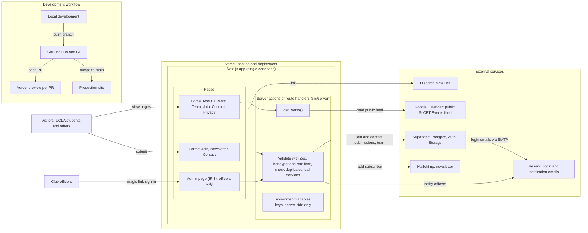

# Architecture

How the site is built. The reasons for each choice, the options we rejected, costs and account owners are in [ADR-0001](adr/0001-stack.md). Update this file when the implementation changes, and write a new ADR when a choice changes.

## System overview

```
Visitor / Officer browser
        │
        ▼
Vercel: one Next.js App Router app
   ├── React pages and components
   └── Server actions or route handlers in src/server
           ├── Supabase: Postgres, Auth (officer magic links), Storage (team photos)
           ├── Resend (login emails, officer notifications)
           ├── Mailchimp (newsletter, double opt-in)
           ├── Google Calendar public feed (events, read by getEvents())
           └── Sentry, cookieless analytics and uptime monitoring
```

There is no separate frontend or API server: pages and server code live in this repository and deploy together to Vercel. Officers sign in with Supabase Auth magic links (sent through Resend); only allowlisted officer emails can sign in. Public visitors do not need accounts in Phase 1.

## Stack

| Layer | Choice |
|---|---|
| Frontend | Next.js App Router, React, strict TypeScript |
| Styling | Tailwind CSS; Figma-exported JSON design tokens; in-repo primitives in a shadcn/ui style |
| Images | `next/image`, with required alt text |
| Server logic | Next.js server actions or route handlers in `src/server` |
| Validation | Zod on every server action and form |
| Authentication | Supabase Auth email magic links, sent via Resend; Phase 1 officer allowlist |
| Officer access | Admin page in the site (IF-3); Supabase dashboard for the tech lead(s) only |
| Bot protection | Honeypot and rate limiting in Phase 1; Turnstile proposed for Phase 2 |
| Database | Supabase Postgres, separate staging and production projects, versioned migrations in the repo, daily keep-alive ping |
| File storage | Supabase Storage for team photos; validate uploads |
| Events | Public "SoCET Events" Google Calendar feed, read by `getEvents()`; `src/content/events.ts` as fallback |
| Newsletter | Mailchimp, double opt-in |
| Email | Resend |
| Hosting | Vercel, with a preview deployment per PR |
| CI | GitHub Actions |
| Tests | Vitest unit tests; Playwright e2e and axe accessibility checks; Lighthouse CI Home budget (planned, TS-3.2) |
| Monitoring | Sentry free tier with PII scrubbing, cookieless analytics and uptime monitoring |

## Data model (Phase 1)

From BE-1.1. Phase 2 adds members, RSVPs, check-in tokens, projects, opportunities, sponsors, site settings, audit log and grid cache (BE-7).

| Entity | Where it lives | Notes |
|---|---|---|
| Officer user / role | Supabase Auth + table | Allowlisted; roles admin and officer |
| Event | Google Calendar feed | Type, start/end, location, Partiful RSVP URL (in the event description). A database table is needed only if officers prefer the admin page (see ADR-0001) |
| Team member | Supabase | Name, role, bio, photo, alt text, sort order |
| Submission | Supabase | Join and contact form entries, with consent text and timestamp. Fields and retention set by DC-4 |
| Newsletter subscriber | Mailchimp | Not stored in our database |

Event types in the plan: speaker, workshop, journal club, site tour, hackathon, social (confirm in open question #38).

## Security and privacy rules

- **Authorization is server-side.** A `requireRole` helper is called in every admin server action, with a test for the denied path.
- **Row-level security is on for every Supabase table.** The service key is used only in server code and never in a `NEXT_PUBLIC_` variable.
- **Validate every server action and form with Zod.** Validate route-handler inputs and query parameters too (e.g. invalid event filters receive a safe validation error or documented default).
- **Collect only approved fields** (decided in DC-4). Don't collect membership data until the privacy page (PD-7) is live and its text matches exactly what is collected.
- **Forms and sign-in:** honeypot and rate limiting in Phase 1. Phase 2 CAPTCHA is proposed to use Cloudflare Turnstile.
- **No third-party iframes or trackers** (e.g. no Google Calendar embed). Read external data on the server instead.
- **Uploads:** validate type and size; alt text required.
- **Secrets** only in Vercel env vars; `.env.example` holds dummy values. Staging and production are separate Supabase projects; seed data is fake and guarded from production.
- **Monitoring** must scrub PII (Sentry) and use cookieless analytics.
- **Accounts** (domain registrar, Vercel, Supabase, Resend, Mailchimp, Google Calendar, Sentry) are owned by a club login, recorded in the account inventory (PH-2).

## Environments

| Environment | Purpose | Data |
|---|---|---|
| Local | Development | Local or staging Supabase, fake seed |
| Preview | One per PR (Vercel) | Staging Supabase project |
| Staging | Integration and officer review before launch | Staging Supabase project |
| Production | Public site | Production Supabase project |

Migrations are versioned in the repo and run on staging first. Vercel previews use staging, never production data. A daily scheduled ping keeps both free Supabase projects from pausing.

## CI checks (TS-3)

GitHub Actions runs on every PR: lint, typecheck, formatting, Vitest unit tests, build, and Playwright e2e with axe accessibility scans. Still to add: Lighthouse CI against the Home-page budget (TS-3.2). A PR needs green CI plus one review to merge.

## Design system

Tokens (color for light and dark at WCAG AA, type, spacing, motion) are exported as JSON from Figma (DS-1.2) and imported into Tailwind (TS-5.1). UI primitives (button, input, form field, card, badge, toast) live in the repo (TS-5.3). Dark mode follows the system preference with no flash.

## Decision records

Put them in `docs/adr/`. Copy `0000-template.md` and number it. [ADR-0001](adr/0001-stack.md) records the stack, costs with free-tier fallbacks and account owners.

## System diagram

Phase 1 scope only. Extra pages and forms (Build With Us, Projects, Resources) are waiting on an officer decision; see ADR-0001.



**In words:** visitors read pages and submit the Join, Newsletter and Contact forms. Each form calls a server action, which validates the input and then stores it in Supabase, adds the person to Mailchimp, or emails officers through Resend. Event pages call `getEvents()`, which reads the public Google Calendar feed on the server, so visitors never load Google's iframe or cookies. Officers sign in with a magic link and manage team members and submissions on the admin page. Every PR gets a Vercel preview, and merging to `main` deploys production.
