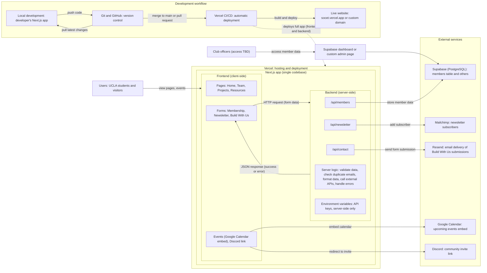

# Architecture

This describes the selected architecture for the single Next.js app. TS-1 records implementation details, service costs and fallbacks. Update this file when the implementation changes.

## System overview

```
Visitor / Officer browser
        │
        ▼
Vercel: one Next.js App Router app
   ├── React pages and components
   └── Server actions and route handlers in src/server
           ├── Postgres (Prisma)
           ├── Object storage (team photos)
           ├── Resend (Auth.js magic links and officer notifications)
           └── Sentry, cookieless analytics and uptime monitoring
```

There is no separate frontend or API server: the app and its server logic live in this repository and deploy together to Vercel. Public pages use server-side data access. Officers authenticate using Auth.js email magic links sent through Resend; only allowlisted officer emails can sign in. Public visitors do not need accounts in Phase 1.

## Selected stack

| Layer | Choice |
|---|---|
| Frontend | Next.js App Router, React, strict TypeScript |
| Styling | Tailwind CSS; Figma-exported JSON design tokens; in-repo primitives in a shadcn/ui style |
| Images | `next/image`, with required alt text |
| Server logic | Next.js server actions and route handlers in `src/server` |
| Validation | Zod on every server action and form |
| Authentication | Auth.js email magic links via Resend; Phase 1 officer allowlist |
| Bot protection | Honeypot and rate limiting in Phase 1; Turnstile proposed for Phase 2 |
| Database | Isolated staging and production Postgres, managed with Prisma migrations |
| File storage | Object storage for team photos; validate uploads |
| Hosting | Vercel, with a preview deployment per PR |
| CI | GitHub Actions |
| Tests | Vitest unit tests; Playwright e2e and axe accessibility checks; Lighthouse CI Home budget |
| Monitoring | Sentry free tier with PII scrubbing, cookieless analytics and uptime monitoring |

## Data model (Phase 1)

From BE-1.1. Phase 2 adds members, RSVPs, check-in tokens, projects, opportunities, sponsors, site settings, audit log and grid cache (BE-7).

| Entity | Notes |
|---|---|
| Officer user / role | Allowlisted; roles admin and officer |
| Event | Type, start/end, location, Partiful RSVP URL; created/updated by |
| Team member | Name, role, bio, photo, alt text, sort order |
| Submission | Join and contact form entries, with consent text and timestamp |
| Newsletter signup | Email, consent text and timestamp. No newsletter is sent in Phase 1 |

Event types in the plan: speaker, workshop, journal club, site tour, hackathon, social (confirm in open question #38).

## Security and privacy rules

- **Authorization is server-side.** A `requireRole` helper is called in every admin server action, with a test for the denied path.
- **Validate every server action and form with Zod.** Validate route-handler inputs and query parameters too (e.g. invalid event filters receive a safe validation error or documented default).
- **Collect only approved fields** (decided in DC-4; privacy policy text must match what is collected exactly).
- **Forms and sign-in:** honeypot and rate limiting in Phase 1. Phase 2 CAPTCHA is proposed to use Cloudflare Turnstile.
- **Uploads:** validate type and size; alt text required.
- **Secrets** only in Vercel env vars; `.env.example` holds dummy values. Staging and production databases are separate; seed data is fake and guarded from production.
- **Monitoring** must scrub PII (Sentry) and use cookieless analytics.
- **Accounts** (domain registrar, Vercel, Resend, Sentry, etc.) are owned by a club login, recorded in the account inventory (PH-2).

## Environments

| Environment | Purpose | Data |
|---|---|---|
| Local | Development | Local DB, fake seed |
| Preview | One per PR (Vercel) | Staging DB |
| Staging | Integration and officer review before launch | Staging Postgres |
| Production | Public site | Production Postgres |

Staging and production are separate Postgres databases. Migrations are versioned with Prisma and run on staging first. Vercel previews use the staging environment, never production data.

## CI checks (TS-3)

The target for every PR is lint, typecheck, unit tests (Vitest), Playwright e2e with axe checks against the preview URL, and Lighthouse CI against the Home-page budget. GitHub Actions already runs lint, typecheck, formatting, tests and build; update it as the remaining checks are wired. A PR needs green CI plus one review to merge.

## Design system

Tokens (color for light and dark at WCAG AA, type, spacing, motion) are exported as JSON from Figma (DS-1.2) and imported into Tailwind (TS-5.1). UI primitives (button, input, form field, card, badge, toast) live in the repo (TS-5.3). Dark mode follows the system preference with no flash.

## Decision records

Put them in `docs/adr/`. Copy `0000-template.md`. TS-1 records the selected stack, paid-service cost table with free-tier fallbacks, a simple diagram, and club-owned accounts.

## System diagram

### Diagram (Mermaid)



### Written description

**Users** (UCLA students and visitors) can view pages, register as a member, sign up for the newsletter, submit a project idea, view events, and join Discord.

**Hosting:** the whole app is hosted on Vercel as one Next.js codebase, with no separate backend server.

**Frontend (client-side):**
- Pages: Home, Team, Projects, Resources
- Forms: Membership, Newsletter, Build With Us
- Embeds and links: Events (Google Calendar embed), Discord link

**Backend (server-side), via Next.js API routes or server actions:**
- `/api/members` stores member data in Supabase
- `/api/newsletter` adds a subscriber in Mailchimp
- `/api/contact` sends the Build With Us submission through Resend
- Server logic: validate form data, check duplicate emails, format data, call external APIs, handle errors
- Environment variables hold API keys, server-side only

**Data flow:** the frontend sends an HTTP request with form data to the backend, and the backend returns a JSON response (success or error).

**External services:**

| Service | Role |
|---|---|
| Supabase (PostgreSQL) | Stores member data (members table, others TBD) |
| Mailchimp | Newsletter subscribers |
| Resend | Emails Build With Us submissions to the club |
| Google Calendar | Embedded upcoming events |
| Discord | Community invite link |

**Development workflow:** a developer works locally, pushes code to GitHub, and merges to `main` (or opens a PR). Vercel CI/CD then builds and deploys automatically to the live site (socet.vercel.app or a custom domain).

**Design and dev tools:** Figma (UI/UX), Next.js (framework), TypeScript (language), Tailwind CSS (styling).

**Security:** API keys live in environment variables, forms are validated, duplicate emails are checked, spam protection is in place, and secrets stay server-side only, never exposed to the client.

**Officer access (TBD):** club officers view member data through the Supabase dashboard or a custom admin page.